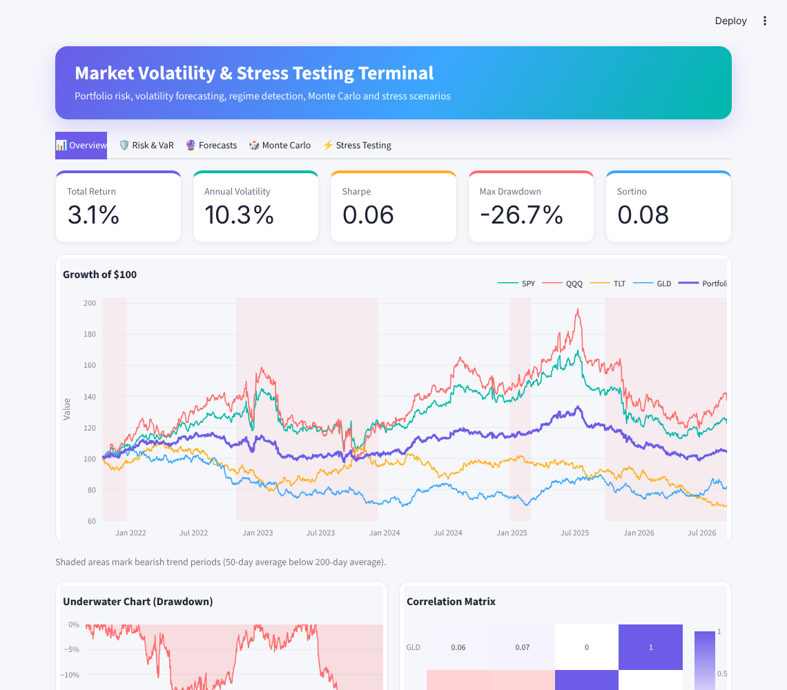
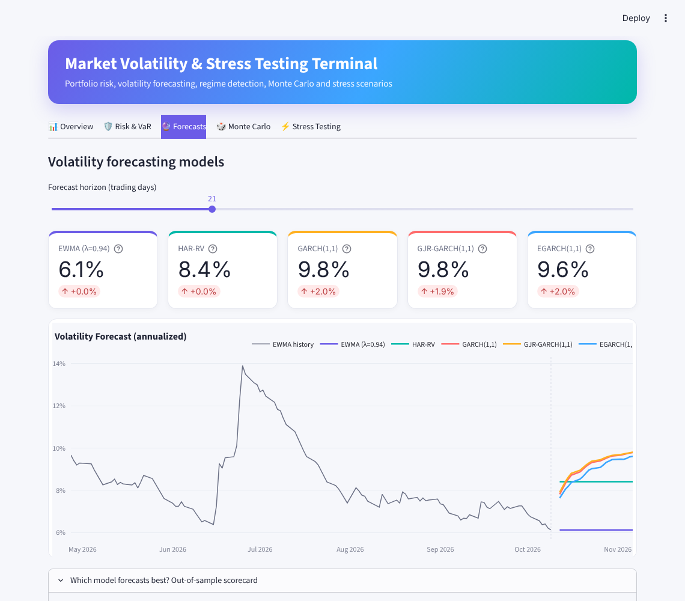
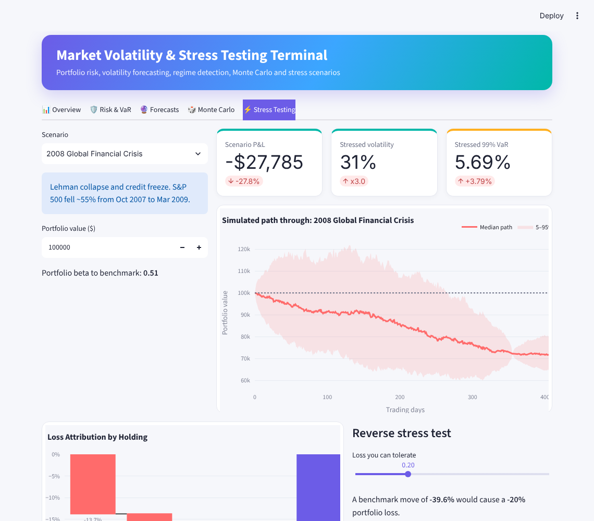

# Market Volatility & Stress Testing Terminal

[](https://github.com/gouravmurmu/MktVol_StressTestingDashboard/actions/workflows/ci.yml)


An interactive portfolio risk terminal: build a multi-asset portfolio, measure tail risk, forecast
volatility with a family of econometric models, detect market regimes, simulate the future and
stress test against historical crises.



## Features

| Tab | What you get |
| --- | --- |
| **Overview** | Weighted multi-asset portfolio, growth of $100 with bear-trend shading, drawdown chart, correlation matrix, per-holding stats and risk contribution |
| **Risk & VaR** | VaR by four methods (Historical, Gaussian, Student-t, Cornish-Fisher), Expected Shortfall, multi-day horizons, and a **VaR backtest** with the Kupiec test so you can see whether a model actually holds up |
| **Forecasts** | Volatility forecasts from **EWMA, HAR-RV, GARCH, GJR-GARCH and EGARCH**, an out-of-sample **model scorecard** (RMSE and QLIKE), and a **Markov-switching regime model** that gives the daily probability of a turbulent market |
| **Monte Carlo** | Four engines: **GJR-GARCH-t**, **block bootstrap**, Student-t GBM and GBM. Fan chart, probability of loss, VaR and Expected Shortfall in dollars |
| **Stress Testing** | Replays of 2008, 2020, the dot-com bust, Black Monday, 2022 and 2011 through each holding's beta, a custom scenario builder, loss attribution waterfall and a **reverse stress test** |

**Demo data mode** generates realistic synthetic markets (regime-switching volatility, fat tails),
so the app works offline. If Yahoo Finance is unreachable, the app falls back to it automatically
and says so.

| Forecasts | Stress testing |
| --- | --- |
|  |  |

## Models in brief

- **GARCH family** (`models/volatility.py`, via [`arch`](https://github.com/bashtage/arch)): Student-t
  innovations. GJR and EGARCH capture the leverage effect (volatility rises more after losses).
- **HAR-RV** (Corsi, 2009): regression of future realized volatility on daily, weekly and monthly
  realized volatility. Simple and hard to beat.
- **Markov switching** (Hamilton, 1989, via `statsmodels`): two regimes with their own mean and
  variance, plus expected regime durations.
- **Backtests** use a strict train/test split: parameters are estimated on the first 70% of the
  sample and forecasts are scored on the remaining 30%.

## Run it

```bash
python -m venv .venv && source .venv/bin/activate
pip install -r requirements.txt
streamlit run ui/app.py
```

Or with Docker:

```bash
docker build -t mktvol . && docker run -p 8501:8501 mktvol
```

## Development

```bash
pip install -r requirements-dev.txt
ruff check .
pytest -q
```

Tests cover the data loader (including the current yfinance column layout), risk math, every
forecasting and simulation model, and a full end-to-end run of the Streamlit app on demo data.

## Project layout

```
data/            price loading, demo data generator, portfolio construction
risk/            VaR/ES, drawdowns, ratios, Kupiec backtest, stress scenarios
models/          volatility forecasting models and backtests
regime/          SMA trend regime and Markov-switching volatility regimes
simulation/      Monte Carlo engines
visualization/   Plotly charts
ui/              Streamlit app, layout and theme
tests/           pytest suite
```

*For education and research. Not investment advice.*
